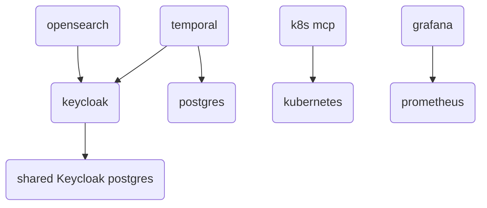

<!-- TODO: describe how .env templates the deployments -->
<!-- TODO: add the Kubernetes dashboard to the kubernetes setup -->
# Deployment factory for Fred using Docker Compose

The `deployment-factory` repository provides the Docker Compose based deployment setup for the `fred-agent` projects ecosystem. It serves as a centralized environment to orchestrate and run the common infrastructure services required by the other `fred-agent` projects.

This project helps to deploy the following support services:
- **Keycloak** – for authentication and identity management
- **SeaweedFS** – for S3-compatible object storage
- **OpenSearch** – for search and analytics capabilities (including vector store capabilities)
- **k3d** - for setting up a dummy kubernetes cluster (used by Fred project only for development purposes)
- **Kubernetes MCP Server** - so that AI agents can interact with Kubernetes clusters
- **Temporal** - for job orchestration
- **Neo4j** - for graph database capabilities (knowledge graphs, relationship querying)
- **Prometheus** - for metrics collection and scraping
- **Grafana** - for dashboards and metrics visualization

This repository aims to simplify local development and testing by providing a ready-to-use, reproducible environment for all shared dependencies across the `fred-agent` projects.

## Switch between Swift and Weaver

Swift and Weaver use the same ports for the applications and their infrastructure.
Only one data stack runs at a time. Each has its own PostgreSQL container and
volume, plus independent SeaweedFS, OpenSearch, Temporal, ClickHouse,
Langfuse/Redis, Prometheus and Grafana state. Switching never copies or deletes
application data. OpenFGA is kept for Swift only; Weaver uses its own `fred_weaver`
database and the bootstrap provided by Fred.

Keycloak is shared: the same `app-keycloak` container, realm, clients, users,
`mirror.gcr.io/keycloak/keycloak:26.3.0` image and port `8080` serve both checkouts.
Its database is stored in a dedicated internal PostgreSQL container
(`app-keycloak-postgres`) with no published host port. This lets either application's
PostgreSQL stop independently. Keycloak identity/client changes apply to both
applications; their business data remains separate.

Run from the repository root, after stopping the application processes from the
checkout you are leaving:

```bash
make docker-down               # leave Weaver; preserve its data
make docker-swift-up           # stop Weaver data containers, create/start Swift
# Or: make docker-swift-up STACK=extended
make docker-swift-env          # usual endpoints, selected data profile
make docker-swift-stop         # stop Swift data; keep containers and volumes
make docker-start              # stop Swift data and resume existing Weaver data
make docker-swift-start        # stop Weaver data and resume existing Swift data
```

Weaver is the default; Swift is in support. Use `docker-up` or `docker-swift-up` the
first time a stack is created. Use `docker-start` or `docker-swift-start` to resume it
without rerunning its
initialization jobs. Add `STACK=extended` to start the extended services too.
Every switch stops all data services of the other environment, including its
extended services. Keycloak and its database stay running.

The generic targets accept `DOCKER_ENV=swift`, for example
`make postgres-up DOCKER_ENV=swift` and `make preflight-check DOCKER_ENV=swift`.
The independent k3d application selector remains `FRED=swift|weaver`.

### Configuration and storage

`docker/.env` configures Swift and shared Keycloak. `docker/.env.weaver` configures
Weaver's data services. Missing files are copied from `.env.template`; existing
files are preserved. Both are ignored by Git. Shared Keycloak always reads its
credentials from `.env`, including when Weaver is selected.
`DOCKER_ENV_FILE=/path/to/file` overrides the selected data configuration;
`DOCKER_SHARED_ENV_FILE=/path/to/file` overrides the shared authentication configuration.
The profiles in `docker/environments/` select resource names and contain no port
overrides or alternative browser hostnames.

Swift keeps the original project, container and volume names. Weaver data projects
and containers use the `weaver-` prefix. For example:

| Stored data | Swift volume | Weaver volume |
| --- | --- | --- |
| PostgreSQL | `postgres_vol-postgres-data` | `weaver-postgres_vol-postgres-data` |
| SeaweedFS | `seaweedfs_vol-seaweedfs-data` | `weaver-seaweedfs_vol-seaweedfs-data` |
| OpenSearch | `opensearch_vol-opensearch-data` | `weaver-opensearch_vol-opensearch-data` |

Both use `fred-shared-network` and the usual service aliases (`app-postgres`,
`app-seaweedfs`, etc.). The launcher stops the other data stack before starting
the selected stack, so the same host ports and aliases address the active data.
The shared Keycloak PostgreSQL volume is `keycloak_vol-keycloak-postgres-data`.

On the first launch with an existing Swift Keycloak database, the launcher copies
that database into the dedicated shared volume. It briefly stops Keycloak for a
consistent copy, retains the source database, and preserves existing accounts and
clients. A failed restore is rolled back and the old Keycloak is restarted.
An initialized shared realm is never overwritten. `docker-up` reconciles
the service clients required by the current Weaver bootstrap without forcing
users to log in again; it preserves their accounts. Resume commands do not run
post-install jobs.
The first migration reuses the legacy PostgreSQL image, and later starts reuse
the shared database's image. `KEYCLOAK_POSTGRES_IMAGE` can select an image explicitly
for a fresh authentication volume. An existing volume requires a real PostgreSQL
upgrade before changing major versions; the launcher rejects copying a newer
source into an older destination before stopping Keycloak.

### Endpoints used by both checkouts

| Service | Host port(s) |
| --- | --- |
| PostgreSQL | 5432 |
| Keycloak | 8080 |
| SeaweedFS S3 | 8333 |
| SeaweedFS master / volume / filer | 9333 / 8081 / 8888 |
| OpenSearch / Dashboards | 9200 / 5601 |
| OpenFGA HTTP / gRPC / playground (Swift only) | 9080 / 9081 / 3000 |
| Temporal API / UI | 7233 / 8233 |
| ClickHouse HTTP / native (`extended`) | 8123 / 9002 |
| Langfuse UI / worker (`extended`) | 3001 / 3030 |
| Prometheus / Grafana (`extended`) | 9090 / 3002 |

Use `localhost` and each checkout's existing database configuration (`fred` for
Swift, `fred_weaver` for Weaver). Keycloak remains at
`http://app-keycloak:8080/realms/app`; keep `127.0.0.1 keycloak app-keycloak` in
`/etc/hosts` for both checkouts' issuer names. Application listening ports stay
unchanged, including frontend `5173`. No Weaver-specific proxy targets or CORS
ports are needed.

`make docker-down` removes Weaver's data containers but keeps their volumes.
`make docker-wipe` deletes Weaver's data containers and volumes. The `docker-swift-*`
commands affect Swift data in the same way. These commands leave shared Keycloak,
its database and the shared network intact. The existing checkpoint commands
support Swift's data volumes only (`DOCKER_ENV=swift`); they do not back up or restore shared authentication.

To inspect a project or run the focused offline command/configuration tests:

```bash
make -s docker-config DOCKER_ENV=swift SVC=postgres
make -s docker-config SVC=keycloak
python3 -m unittest bin/test_docker_environments.py
```

## Manual Swift setup

### Docker Bridge network

All these docker-compose files share the same network called `fred-shared-network`. So first, create the shared network with the following command line.

```
docker network create fred-shared-network --driver bridge
```

### Name resolution (optional)

If the browser used to access Fred's frontend or OpenSearch dashboards (basically all the UIs that may use Keycloak for SSO) is on the same machine as the one where Keycloak is hosted as a container, please add the entry `127.0.0.1 app-keycloak` into your docker host `/etc/hosts` so that your web browser can reach Keycloak instance for authentication:

```sh
grep -q '127.0.0.1.*app-keycloak' /etc/hosts || echo "127.0.0.1 app-keycloak" | sudo tee -a /etc/hosts
```

## Configuration

Please create a ``.env`` file in the ``docker-compose`` to customize your deployment by copying and adapting the ``docker/.env.template`` file:


```bash
cp docker/.env.template docker/.env
```

Here are **examples** of custom deployment params you can modify:
- ``DOCKER_COMPOSE_HOST_FQDN``
- ``POSTGRES_ADMIN_PASSWORD``
- ``POSTGRES_MAX_CONNECTIONS``
- ``KEYCLOAK_AGENTIC_CLIENT_SECRET``
- ``KEYCLOAK_KNOWLEDGE_FLOW_CLIENT_SECRET``
- ``KEYCLOAK_CONTROL_PLANE_CLIENT_SECRET``
- ``KEYCLOAK_FORCE_RELOGIN``
- ``TEMPORAL_UI_PORT``
- ``SEAWEEDFS_ADMIN_USER``
- ``SEAWEEDFS_ADMIN_PASSWORD``
- ``OPENSEARCH_ADMIN_PASSWORD``
- ``PROMETHEUS_PORT``
- ``PROMETHEUS_RETENTION``
- ``GRAFANA_PORT``
- ``GRAFANA_ADMIN_USER``
- ``GRAFANA_ADMIN_PASSWORD``

## Deployment


All these services can be started separately.

Keycloak is already configured with some clients and roles - no users are pre-provisioned.

OpenSearch is already configured to be connected to Keycloak. This is a graph to show the dependencies between compose files:



Launch the components according to your needs with these command lines:

- Keycloak
```
make keycloak-up
```

The Keycloak post-install script is idempotent and enforces:
- clients `app`, `agentic`, `knowledge-flow`, `control-plane`, `fred-evaluation-worker`
- `agentic`, `knowledge-flow`, `control-plane`, and `fred-evaluation-worker` as confidential
  clients with service accounts enabled
- service account roles: `agentic`, `knowledge-flow`, and `control-plane` get `realm-management`
  `query-users`/`view-users` (plus `manage-users` for `control-plane` always, and for
  `knowledge-flow` when `KEYCLOAK_KF_ENABLE_MANAGE_USERS=true`); every one of the four service
  accounts, including `fred-evaluation-worker`, gets `app:service_agent` (the evaluation worker
  gets no `realm-management` role - least privilege, RFC EVAL-AUTH). No
  group-scoped role (`query-groups`/`view-groups`) is ever granted - no app calls a Keycloak
  group-admin API (Fred is the sole authorization source).
- trusted delegation: a `fred-delegation` client (issues no tokens) carries the
  `delegation_caller` role. `agentic`, `knowledge-flow`, `control-plane`, and
  `fred-evaluation-worker` hold it; the last three also get a scope mapping to `fred-delegation`.
  Their service tokens therefore carry `resource_access.fred-delegation.roles: [delegation_caller]`
  and `fred-delegation` in `aud`, so receivers accept them speaking for a person. The
  evaluation worker uses this to call the agent pods' `POST /agents/evaluate` with its own
  service token plus `?person=&run=&agent=`. This trusts the caller to assert an identity; it
  grants no content permission.
- client roles: only `app:service_agent` exists on the `app` client - the legacy
  `admin`/`editor`/`viewer` roles were removed from the tracked realm import entirely (AUTHZ-07);
  team and platform roles live in Fred, never as Keycloak app roles or groups
- an **empty realm import**: `.users` and `.groups` are both `[]` in the tracked
  `app-realm.json.template`. Keycloak auto-creates each confidential client's
  `service-account-<clientId>` user at import time (`serviceAccountsEnabled=true`), and the
  post-install script grants it the roles above - no user or role assignment is baked into the
  tracked JSON. Self-registration is enabled on the `app` client, so the first human simply
  registers through Keycloak's own registration screen.
- forced user re-login after a Keycloak wipe (`KEYCLOAK_FORCE_RELOGIN=auto` or `true`)

The very first `platform_admin` goes through `POST /bootstrap/platform-admin` (AUTHZ-07) -
see the root README.

### Platform and demo-data provisioning lives in `fred`

This repo carries no user, team, or role data - not even for local demos. Fred Weaver's
control plane owns it: `make bundle-demo` in the Fred checkout builds the demo bundle, and a
platform administrator imports it from **Provisioning** in the Fred UI.

<!-- TODO: Need to check how we can specify hard dependency between Keycloak and depending services (OpenSearch, Temporal) -->

- SeaweedFS
```
docker compose -f docker/docker-compose-seaweedfs.yml -p seaweedfs up -d
```

The SeaweedFS post-install job pre-creates the buckets `langfuse` and
`app-content-documents` (Fred Weaver's documents).

- OpenSearch
```
docker compose -f docker/docker-compose-opensearch.yml -p opensearch up -d
```


- Lightweight Kubernetes distribution (k3d)
```
docker compose -f docker/docker-compose-kubernetes.yml -p kubernetes up -d
```

- Kubernetes MCP Server
```
docker compose -f docker/docker-compose-k8s-mcp.yml -p k8s-mcp up -d
```

- Temporal
```
docker compose -f docker/docker-compose-temporal.yml -p temporal up -d
```

- Neo4j
```
docker compose -f docker/docker-compose-neo4j.yml -p neo4j up -d
```

- Prometheus
```
docker compose -f docker/docker-compose-prometheus.yml -p prometheus up -d
```

- Grafana
```
docker compose -f docker/docker-compose-grafana.yml -p grafana up -d
```

Prometheus starts with self-scraping enabled and can load additional static targets from `docker/prometheus/targets/*.yml`.
It also scrapes the native metrics endpoints exposed in Docker Compose mode for:
- `Keycloak` on `app-keycloak:9000/metrics`
- `ClickHouse` on `app-clickhouse:9363/metrics`
- `Temporal` on `app-temporal:9090/metrics`
- `SeaweedFS` on `app-seaweedfs:9327/metrics`

Grafana is pre-provisioned with a Prometheus datasource pointing to `http://app-prometheus:9090` on the shared Docker network.

### Optional Zabbix 7.0 LTS

Zabbix uses a dedicated `zabbix` database and user in the shared `app-postgres`
instance. It is disabled by default in both the `base` and `extended` stacks.
Its server joins `fred-shared-network` to reach Compose exporters. The web UI
listens on localhost only. Docker Compose, a running Docker daemon, and Fred's
Prometheus template are the prerequisites; Fred's application processes can be
started separately.

From the root of this repository, run:

```bash
make docker-up USE_ZABBIX=true
docker compose -f docker/docker-compose-zabbix.yml -p zabbix ps
```

Use `make docker-start USE_ZABBIX=true` to resume it after `make docker-stop`.
On an existing stack, `make zabbix-up` starts Zabbix directly. The Zabbix
database is created in `app-postgres` only when Zabbix starts. Set
`POSTGRES_ZABBIX_USER`, `POSTGRES_ZABBIX_DB`, `ZABBIX_DB_PASSWORD`,
`ZABBIX_PORT`, or `ZABBIX_TIMEZONE` in `docker/.env` before the first start.
`USE_ZABBIX` is a Make variable, so pass it on the command line or export it
in your shell.

`make zabbix-up` waits for the Zabbix API, imports Fred's template, and
configures the four development exporters. Rerunning it checks the existing
hosts without duplicating them. The template is read from the sibling Fred
checkout at `../fred/deploy/zabbix/fred-prometheus-by-http.yaml`. If that file
is absent, an already imported template is reused. On a fresh Zabbix database,
pass the template's local path until it is available on your Fred branch:

```bash
make zabbix-up ZABBIX_TEMPLATE_FILE=/path/to/fred-prometheus-by-http.yaml
```

Open <http://localhost:8085> and sign in as `Admin` / `zabbix` on a fresh
installation. Change the administrator password before sharing this instance.
The default database password is for local development only.

The stock **Zabbix server** host uses **Linux by Zabbix agent**, but this
minimal project does not run an agent. To avoid an unrelated availability
alarm, set that host to **Disabled** under **Data collection > Hosts**. If the
alarm is already open, close it under **Monitoring > Problems**. Leave the
Prometheus template host enabled.

To import or recheck Fred's configuration without starting Zabbix again, run:

```bash
make zabbix-provision-fred
```

The provisioning command stops if a host with the same name has a different
template or metrics URL.
Set `ZABBIX_API_URL`, `ZABBIX_ADMIN_USER`, or `ZABBIX_ADMIN_PASSWORD` in the
environment if the local Zabbix API or credentials differ from the defaults.

The HTTP scraping targets are defined in `bin/zabbix-provision-fred.py` and
installed as `{$FRED.METRICS.URL}` macros on these hosts:

| Fred process | `{$FRED.METRICS.URL}` |
| --- | --- |
| Agents API | `http://host.docker.internal:9000/metrics` |
| Knowledge Flow API | `http://host.docker.internal:9111/metrics` |
| Knowledge Flow worker | `http://host.docker.internal:9112/metrics` |
| Control Plane API | `http://host.docker.internal:9222/metrics` |

The Zabbix template defines the HTTP agent request, discovery, and numeric
metric items. The provisioning script configures scraping after Compose starts
Zabbix.
For a Compose exporter, use its service name and port on
`fred-shared-network`. Use a separate Zabbix host for each exporter instance.

After two one-minute polls (discovery, then item values), open **Monitoring >
Latest data** and select a Fred host. `fred.prometheus.raw` and
`fred.prometheus.parsed` should be supported, with discovered numeric series
and values. **Data collection > Hosts** shows the template and URL macro for
each host.

The three APIs start with `make run` in the Fred checkout. Start the Knowledge
Flow worker separately with `make -C apps/knowledge-flow-backend run-worker`.
The Control Plane worker can run separately too, but its current
development configuration has no `/metrics` exporter. A host for a stopped
process will show an unsupported HTTP item until that process starts.

The existing OpenFGA exporter can serve as a template smoke test at
`http://openfga:2112/metrics`. It does not validate Fred metrics.

`make zabbix-down` removes the Zabbix containers and keeps their database in
the shared PostgreSQL volume. `make zabbix-up` resumes the saved database.
`make docker-stop` also stops Zabbix; resume it with
`make docker-start USE_ZABBIX=true` or `make zabbix-up`. `make docker-wipe`
deletes the Zabbix database along with the other PostgreSQL databases. Existing
data in the former `zabbix_vol-zabbix-db` volume is not migrated automatically.

## Access the service interfaces

> :key: For development purposes, the password for nominative or service accounts is `Azerty123_`

`make docker-up` alone creates **no** nominative account. A new installation starts
with an empty Keycloak realm; an existing shared realm is preserved. To get working accounts, either:

- self-register through Keycloak's own registration screen, then complete the AUTHZ-07
  `/bootstrap` flow to become the first `platform_admin`; or
- import `fred`'s demo bundle from **Provisioning** (see "Platform and demo-data
  provisioning lives in `fred`" above). Keycloak only ever carries the identity
  (username/email/password); every authorization role lives in Fred, never as a Keycloak
  app role or group.

Hereunder, these are the information to connect to each service with their _local service accounts_.

### Keycloak

- URL: http://$(DOCKER_COMPOSE_HOST_FQDN):8080
- Service accounts:
  - `admin`
- Realm: `app`

### ClickHouse

- URLs:
  - http://$(DOCKER_COMPOSE_HOST_FQDN):8123 (HTTP API)
  - http://$(DOCKER_COMPOSE_HOST_FQDN):8123/play (built-in SQL UI)
  - tcp://$(DOCKER_COMPOSE_HOST_FQDN):9002 (native protocol)
- Service accounts:
  - `${CLICKHOUSE_USER}` (default from `.env.template`: `fred`)

### Langfuse

- URLs:
  - http://$(DOCKER_COMPOSE_HOST_FQDN):$(LANGFUSE_UI_PORT) (web-ui, default: `3001`)
- S3 bucket (default in `.env.template`):
  - `LANGFUSE_S3_EVENT_UPLOAD_BUCKET=langfuse`
  - `LANGFUSE_S3_MEDIA_UPLOAD_BUCKET=langfuse`
  - `LANGFUSE_S3_BATCH_EXPORT_BUCKET=langfuse`
- First-time setup:
  - Create your user account from the Langfuse UI (`Sign up`).
  - Create an organization.
  - Create a project in that organization.
  - Generate API keys in `Settings` -> `Projects` -> `<Project name>` -> `API Keys`.
  - Use the generated values as `LANGFUSE_PUBLIC_KEY` and `LANGFUSE_SECRET_KEY` in your environment variable file, typically `.env` in Fred.

### Grafana

- URL:
  - http://$(DOCKER_COMPOSE_HOST_FQDN):$(GRAFANA_PORT) (default: `3002`)
- Default admin account:
  - `${GRAFANA_ADMIN_USER}` / `${GRAFANA_ADMIN_PASSWORD}`

### SeaweedFS

- URLs:
  - http://$(DOCKER_COMPOSE_HOST_FQDN):8333 (S3 API)
  - http://$(DOCKER_COMPOSE_HOST_FQDN):8888 (Filer API)
  - http://$(DOCKER_COMPOSE_HOST_FQDN):9333 (Master API)
  - http://$(DOCKER_COMPOSE_HOST_FQDN):8081 (Volume API)
- Note:
  - the SeaweedFS Volume API is intentionally exposed on host port `8081` because host port `8080` is already used by Keycloak
- Service accounts:
  - `admin` (admin)
- Buckets:
   - `langfuse`
   - `app-content-documents`

### OpenSearch

- URLs:
  - http://$(DOCKER_COMPOSE_HOST_FQDN):5601 (dashboard)
  - https://$(DOCKER_COMPOSE_HOST_FQDN):9200 (service)
- Service accounts:
  - `admin` (admin)
  - `app_ro` (read-only)
  - `app_rw` (read-write)
 - Indexes: none at install; Fred Weaver creates `document-vectors-<organization_id>` (one corpus per organization) and `weaver-kpi`

### Temporal

- URLs:
  - http://$(DOCKER_COMPOSE_HOST_FQDN):$(TEMPORAL_UI_PORT) (web-ui, default: `8233`)

### Neo4j

- URLs:
  - http://$(DOCKER_COMPOSE_HOST_FQDN):7474 (Browser / HTTP API)
  - bolt://$(DOCKER_COMPOSE_HOST_FQDN):7687 (Bolt protocol)
- Service accounts:
  - `neo4j` (default superuser)

### Prometheus

- URLs:
  - http://$(DOCKER_COMPOSE_HOST_FQDN):$(PROMETHEUS_PORT) (web UI / API, default: `9090`)

## Local structured logs

With the existing Docker foundation running, `make logging-up` starts Loki and Alloy
and the existing Grafana on http://localhost:3002. It preserves `docker/.env`.
Open http://localhost:3002/d/fred-local-logs/fred-logs (also the default home dashboard).
The compact view shows **timestamp · severity · service · message**, with stable
service colors and Grafana's native severity colors.
Use the **Service** and **Severity** dropdowns to select one or more values.
Expand a line for all parsed fields and its original **raw_record**, then use
the include/exclude buttons to add **Field filters**; clear them to reset the view.
The dashboard keeps raw records in Loki unchanged and formats only query results.
Native text lines remain visible when All is selected. Severity appears once, in
Grafana's native level column beside the timestamp. In expanded details, `severity`
is the collected severity and the only severity-related field shown. An Extract
fields panel transformation maps it to Grafana's internal level column, preserving
native colors without adding another field to log details. Loki still stores
`detected_level` as structured metadata (`discover_log_levels` defaults to true);
the query uses it only as a fallback for native text without Fred severity, then
hides it from the dashboard results. The query also hides redundant `level` fields
and duplicate `service_extracted`, `service_role_extracted` and
`severity_extracted` fields created when JSON keys match collected labels.
Original fields remain available in `raw_record`.
Refresh is manual by default so an expanded log stays open; the refresh menu
can enable automatic updates.

Local Docker Grafana is pinned to 12.4.11 for the native log panel and field-filter
controls; `GRAFANA_IMAGE` overrides the image. For free-form queries, open **Explore**,
select the **Fred Logs** datasource and use `{environment="dev"} | json`.

Select `app.log_format: json` in local Fred API/worker configuration, and capture
stdout/stderr to one `*.log` file per process under `/tmp/fred-structured-logs`.
The launcher restricts this directory to its owner (0700) and captured logs to
0600; Alloy reads the mounted directory as container root.
Override that directory with `FRED_LOG_DIR=/absolute/path make logging-up`.
The directory must be readable by the collector. Docker applications opt in with
the container label `fred.logs=true`; unrelated dependency logs are not collected.
The Docker socket grants the collector Docker API access even when mounted read-only.

Loki retains logs for 72 hours in a named volume; Alloy persists reader positions.
The collector recognizes Python seconds/nanoseconds, nginx ISO timestamps and audit
epoch timestamps, preserves original lines and keeps native text diagnostics.
Only environment, source, service, service role, severity and source file/container
are labels; operation and identity references remain queryable JSON fields.

Useful queries:

```logql
{environment="dev", severity=~"ERROR|CRITICAL"} | json
{environment="dev"} | json | correlation_id="YOUR_ID"
{environment="dev", service_role="worker"} | json | document_id="YOUR_ID"
{environment="dev", service="frontend"} | json | http_status >= 400
```

`make logging-down` stops collection without deleting stored logs. The extended
Docker stack includes logging; the ordinary stop/down/wipe commands handle it too.
This validates local output and field queries; GKE timestamp/severity promotion
still requires a canary in Cloud Logging.

### Switch Fred between terminal and Grafana

From deployment-factory, with a Fred Weaver checkout prepared by `make docker-prepare`:

```bash
make fred-json FRED_CHECKOUT=/path/to/fred   # starts Loki/Alloy/Grafana, then Fred
# Ctrl+C stops all six Fred processes; collectors stay running.
make fred-text FRED_CHECKOUT=/path/to/fred   # the same processes, readable logs in this terminal
```

It starts what `make -C /path/to/fred run` starts, with the same commands and ports:
Control Plane (8222), Knowledge Flow API (8111) and worker, Fred Agents API (8000)
and capability worker, frontend (<http://localhost:5173>). The only difference is
`app.log_format`, set in a temporary copy of each configuration; tracked
configurations and `.env` files are untouched. JSON mode appends one log file per
component to `FRED_LOG_DIR` (default `/tmp/fred-structured-logs`), the directory
Alloy reads; text mode prints to the terminal.

Logs: <http://localhost:3002/d/fred-local-logs/fred-logs> (user `admin`, the local
password `Azerty123_`). From another terminal, `make fred-stop` stops only the
recorded launcher session. The launcher refuses to start while a Fred port is
occupied or another session owns the log directory.
