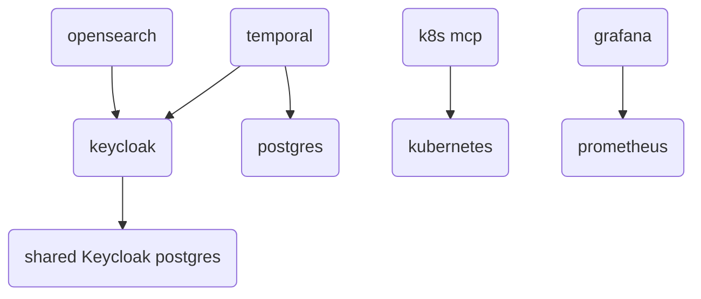

<!-- TODO: Rajouter l'histoire du .env pour templatiser les déploiements  -->
<!-- TODO: Rajouter Kube dashboard dans le kubernetes -->
# Deployment factory for Fred using Docker Compose

The `deployment-factory` repository provides the Docker Compose based deployment setup for the `fred-agent` projects ecosystem. It serves as a centralized environment to orchestrate and run the common infrastructure services required by the other `fred-agent` projects.

This project helps to deploy the following support services:
- **Keycloak** – for authentication and identity management
- **SeaweedFS** – for S3-compatible object storage
- **OpenSearch** – for search and analytics capabilities (including vector store capabilities)
- **k3d** - for setting up a dummy kubernetes cluster (used by Fred project only for development purposes)
- **Kubernetes MCP Server** - so that AI agents can interact with Kubernetes clusters
- **Temporal** - for job orchestration
- **Neo4j** - for graph database capabilities (knowledge graphs, relationship querying)
- **Prometheus** - for metrics collection and scraping
- **Grafana** - for dashboards and metrics visualization

This repository aims to simplify local development and testing by providing a ready-to-use, reproducible environment for all shared dependencies across the `fred-agent` projects.

## Switch between Swift and Weaver

Swift and Weaver use the same ports for the applications and their infrastructure.
Only one data stack runs at a time. Each has its own PostgreSQL container and
volume, plus independent SeaweedFS, OpenSearch, Temporal, ClickHouse,
Langfuse/Redis, Prometheus and Grafana state. Switching never copies or deletes
application data. OpenFGA is kept for Swift only; Weaver uses its own `fred_weaver`
database and the bootstrap provided by Fred.

Keycloak is shared: the same `app-keycloak` container, realm, clients, users,
`mirror.gcr.io/keycloak/keycloak:26.3.0` image and port `8080` serve both checkouts.
Its database is stored in a dedicated internal PostgreSQL container
(`app-keycloak-postgres`) with no published host port. This lets either application's
PostgreSQL stop independently. Keycloak identity/client changes apply to both
applications; their business data remains separate.

Run from the repository root, after stopping the application processes from the
checkout you are leaving:

```bash
make docker-down               # leave Swift; preserve its data
make docker-weaver-up          # stop Swift data containers, create/start Weaver
# Or: make docker-weaver-up STACK=extended
make docker-weaver-env         # usual endpoints, selected data profile
make docker-weaver-stop        # stop Weaver data; keep containers and volumes
make docker-start              # stop Weaver data and resume existing Swift data
make docker-weaver-start       # stop Swift data and resume existing Weaver data
```

Use `docker-up` or `docker-weaver-up` the first time a stack is created. Use
`docker-start` or `docker-weaver-start` to resume it without rerunning its
initialization jobs. Add `STACK=extended` to start the extended services too.
Every switch stops all data services of the other environment, including its
extended services. Keycloak and its database stay running.

The generic targets accept `DOCKER_ENV=weaver`, for example
`make postgres-up DOCKER_ENV=weaver` and `make preflight-check DOCKER_ENV=weaver`.
The independent k3d application selector remains `FRED=swift|weaver`.

### Configuration and storage

`docker/.env` configures Swift and shared Keycloak. `docker/.env.weaver` configures
Weaver's data services. Missing files are copied from `.env.template`; existing
files are preserved. Both are ignored by Git. Shared Keycloak always reads its
credentials from `.env`, including when Weaver is selected.
`DOCKER_ENV_FILE=/path/to/file` overrides the selected data configuration;
`DOCKER_SHARED_ENV_FILE=/path/to/file` overrides the shared authentication configuration.
The profiles in `docker/environments/` select resource names and contain no port
overrides or alternative browser hostnames.

Swift keeps the original project, container and volume names. Weaver data projects
and containers use the `weaver-` prefix. For example:

| Stored data | Swift volume | Weaver volume |
| --- | --- | --- |
| PostgreSQL | `postgres_vol-postgres-data` | `weaver-postgres_vol-postgres-data` |
| SeaweedFS | `seaweedfs_vol-seaweedfs-data` | `weaver-seaweedfs_vol-seaweedfs-data` |
| OpenSearch | `opensearch_vol-opensearch-data` | `weaver-opensearch_vol-opensearch-data` |

Both use `fred-shared-network` and the usual service aliases (`app-postgres`,
`app-seaweedfs`, etc.). The launcher stops the other data stack before starting
the selected stack, so the same host ports and aliases address the active data.
The shared Keycloak PostgreSQL volume is `keycloak_vol-keycloak-postgres-data`.

On the first launch with an existing Swift Keycloak database, the launcher copies
that database into the dedicated shared volume. It briefly stops Keycloak for a
consistent copy, retains the source database, and preserves existing accounts and
clients. A failed restore is rolled back and the old Keycloak is restarted.
An initialized shared realm is never overwritten. `docker-weaver-up` reconciles
the service clients required by the current Weaver bootstrap without forcing
users to log in again; it preserves their accounts. Resume commands do not run
post-install jobs.
The first migration reuses the legacy PostgreSQL image, and later starts reuse
the shared database's image. `KEYCLOAK_POSTGRES_IMAGE` can select an image explicitly
for a fresh authentication volume. An existing volume requires a real PostgreSQL
upgrade before changing major versions; the launcher rejects copying a newer
source into an older destination before stopping Keycloak.

### Endpoints used by both checkouts

| Service | Host port(s) |
| --- | --- |
| PostgreSQL | 5432 |
| Keycloak | 8080 |
| SeaweedFS S3 | 8333 |
| SeaweedFS master / volume / filer | 9333 / 8081 / 8888 |
| OpenSearch / Dashboards | 9200 / 5601 |
| OpenFGA HTTP / gRPC / playground (Swift only) | 9080 / 9081 / 3000 |
| Temporal API / UI | 7233 / 8233 |
| ClickHouse HTTP / native (`extended`) | 8123 / 9002 |
| Langfuse UI / worker (`extended`) | 3001 / 3030 |
| Prometheus / Grafana (`extended`) | 9090 / 3002 |

Use `localhost` and each checkout's existing database configuration (`fred` for
Swift, `fred_weaver` for Weaver). Keycloak remains at
`http://app-keycloak:8080/realms/app`; keep `127.0.0.1 keycloak app-keycloak` in
`/etc/hosts` for both checkouts' issuer names. Application listening ports stay
unchanged, including frontend `5173`. No Weaver-specific proxy targets or CORS
ports are needed.

`make docker-weaver-down` removes Weaver's data containers but keeps their volumes.
`make docker-weaver-wipe` deletes Weaver's data containers and volumes. The Swift
commands affect Swift data in the same way. These commands leave shared Keycloak,
its database and the shared network intact. The existing checkpoint commands
support Swift's data volumes only; they do not back up or restore shared authentication.

To inspect a project or run the focused offline command/configuration tests:

```bash
make -s docker-config DOCKER_ENV=weaver SVC=postgres
make -s docker-config SVC=keycloak
python3 -m unittest bin/test_docker_environments.py
```

## Manual Swift setup

### Docker Bridge network

All these docker-compose files share the same network called `fred-shared-network`. So first, create the shared network with the following command line.

```
docker network create fred-shared-network --driver bridge
```

### Name resolution (optional)

If the browser used to access Fred's frontend or OpenSearch dashboards (basically all the UIs that may use Keycloak for SSO) is on the same machine as the one where Keycloak is hosted as a container, please add the entry `127.0.0.1 app-keycloak` into your docker host `/etc/hosts` so that your web browser can reach Keycloak instance for authentication:

```sh
grep -q '127.0.0.1.*app-keycloak' /etc/hosts || echo "127.0.0.1 app-keycloak" | sudo tee -a /etc/hosts
```

## Configuration

Please create a ``.env`` file in the ``docker-compose`` to customize your deployment by copying and adapting the ``docker/.env.template`` file:


```bash
cp docker/.env.template docker/.env
```

Here are **examples** of custom deployment params you can modify:
- ``DOCKER_COMPOSE_HOST_FQDN``
- ``POSTGRES_ADMIN_PASSWORD``
- ``POSTGRES_MAX_CONNECTIONS``
- ``KEYCLOAK_AGENTIC_CLIENT_SECRET``
- ``KEYCLOAK_KNOWLEDGE_FLOW_CLIENT_SECRET``
- ``KEYCLOAK_CONTROL_PLANE_CLIENT_SECRET``
- ``KEYCLOAK_FORCE_RELOGIN``
- ``TEMPORAL_UI_PORT``
- ``SEAWEEDFS_ADMIN_USER``
- ``SEAWEEDFS_ADMIN_PASSWORD``
- ``OPENSEARCH_ADMIN_PASSWORD``
- ``PROMETHEUS_PORT``
- ``PROMETHEUS_RETENTION``
- ``GRAFANA_PORT``
- ``GRAFANA_ADMIN_USER``
- ``GRAFANA_ADMIN_PASSWORD``

## Deployment


All these services can be started separately.

Keycloak is already configured with some clients and roles - no users are pre-provisioned.

OpenSearch is already configured to be connected to Keycloak. This is a graph to show the dependencies between compose files:



Launch the components according to your needs with these command lines:

- Keycloak
```
make keycloak-up
```

The Keycloak post-install script is idempotent and enforces:
- clients `app`, `agentic`, `knowledge-flow`, `control-plane`, `fred-evaluation-worker`
- `agentic`, `knowledge-flow`, `control-plane`, and `fred-evaluation-worker` as confidential
  clients with service accounts enabled
- service account roles: `agentic`, `knowledge-flow`, and `control-plane` get `realm-management`
  `query-users`/`view-users` (plus `manage-users` for `control-plane` always, and for
  `knowledge-flow` when `KEYCLOAK_KF_ENABLE_MANAGE_USERS=true`); every one of the four service
  accounts, including `fred-evaluation-worker`, gets `app:service_agent` (the evaluation worker
  gets `service_agent` only, no `realm-management` role - least privilege, RFC EVAL-AUTH). No
  group-scoped role (`query-groups`/`view-groups`) is ever granted - no app calls a Keycloak
  group-admin API (Fred is the sole authorization source).
- client roles: only `app:service_agent` exists on the `app` client - the legacy
  `admin`/`editor`/`viewer` roles were removed from the tracked realm import entirely (AUTHZ-07);
  team and platform roles live in Fred, never as Keycloak app roles or groups
- an **empty realm import**: `.users` and `.groups` are both `[]` in the tracked
  `app-realm.json.template`. Keycloak auto-creates each confidential client's
  `service-account-<clientId>` user at import time (`serviceAccountsEnabled=true`), and the
  post-install script grants it the roles above - no user or role assignment is baked into the
  tracked JSON. Self-registration is enabled on the `app` client, so the first human simply
  registers through Keycloak's own registration screen.
- forced user re-login after a Keycloak wipe (`KEYCLOAK_FORCE_RELOGIN=auto` or `true`)

The very first `platform_admin` goes through `POST /bootstrap/platform-admin` (AUTHZ-07) -
see the root README.

### Platform and demo-data provisioning lives in `fred`

This repo carries no user, team, or role data - not even for local demos. Fred Weaver's
control plane owns it: `make bundle-demo` in the Fred checkout builds the demo bundle, and a
platform administrator imports it from **Provisioning** in the Fred UI.

<!-- TODO: Need to check how we can specify hard dependency between Keycloak and depending services (OpenSearch, Temporal) -->

- SeaweedFS
```
docker compose -f docker/docker-compose-seaweedfs.yml -p seaweedfs up -d
```

The SeaweedFS post-install job pre-creates the buckets `langfuse` and
`app-content-documents` (Fred Weaver's documents).

- OpenSearch
```
docker compose -f docker/docker-compose-opensearch.yml -p opensearch up -d
```


- Lightweight Kubernetes distribution (k3d)
```
docker compose -f docker/docker-compose-kubernetes.yml -p kubernetes up -d
```

- Kubernetes MCP Server
```
docker compose -f docker/docker-compose-k8s-mcp.yml -p k8s-mcp up -d
```

- Temporal
```
docker compose -f docker/docker-compose-temporal.yml -p temporal up -d
```

- Neo4j
```
docker compose -f docker/docker-compose-neo4j.yml -p neo4j up -d
```

- Prometheus
```
docker compose -f docker/docker-compose-prometheus.yml -p prometheus up -d
```

- Grafana
```
docker compose -f docker/docker-compose-grafana.yml -p grafana up -d
```

Prometheus starts with self-scraping enabled and can load additional static targets from `docker/prometheus/targets/*.yml`.
It also scrapes the native metrics endpoints exposed in Docker Compose mode for:
- `Keycloak` on `app-keycloak:9000/metrics`
- `ClickHouse` on `app-clickhouse:9363/metrics`
- `Temporal` on `app-temporal:9090/metrics`
- `SeaweedFS` on `app-seaweedfs:9327/metrics`

Grafana is pre-provisioned with a Prometheus datasource pointing to `http://app-prometheus:9090` on the shared Docker network.

## Access the service interfaces

> :key: For development purposes, the password for nominative or service accounts is `Azerty123_`

`make docker-up` alone creates **no** nominative account. A new installation starts
with an empty Keycloak realm; an existing shared realm is preserved. To get working accounts, either:

- self-register through Keycloak's own registration screen, then complete the AUTHZ-07
  `/bootstrap` flow to become the first `platform_admin`; or
- import `fred`'s demo bundle from **Provisioning** (see "Platform and demo-data
  provisioning lives in `fred`" above). Keycloak only ever carries the identity
  (username/email/password); every authorization role lives in Fred, never as a Keycloak
  app role or group.

Hereunder, these are the information to connect to each service with their _local service accounts_.

### Keycloak

- URL: http://$(DOCKER_COMPOSE_HOST_FQDN):8080
- Service accounts:
  - `admin`
- Realm: `app`

### ClickHouse

- URLs:
  - http://$(DOCKER_COMPOSE_HOST_FQDN):8123 (HTTP API)
  - http://$(DOCKER_COMPOSE_HOST_FQDN):8123/play (built-in SQL UI)
  - tcp://$(DOCKER_COMPOSE_HOST_FQDN):9002 (native protocol)
- Service accounts:
  - `${CLICKHOUSE_USER}` (default from `.env.template`: `fred`)

### Langfuse

- URLs:
  - http://$(DOCKER_COMPOSE_HOST_FQDN):$(LANGFUSE_UI_PORT) (web-ui, default: `3001`)
- S3 bucket (default in `.env.template`):
  - `LANGFUSE_S3_EVENT_UPLOAD_BUCKET=langfuse`
  - `LANGFUSE_S3_MEDIA_UPLOAD_BUCKET=langfuse`
  - `LANGFUSE_S3_BATCH_EXPORT_BUCKET=langfuse`
- First-time setup:
  - Create your user account from the Langfuse UI (`Sign up`).
  - Create an organization.
  - Create a project in that organization.
  - Generate API keys in `Settings` -> `Projects` -> `<Project name>` -> `API Keys`.
  - Use the generated values as `LANGFUSE_PUBLIC_KEY` and `LANGFUSE_SECRET_KEY` in your environment variable file, typically `.env` in Fred.

### Grafana

- URL:
  - http://$(DOCKER_COMPOSE_HOST_FQDN):$(GRAFANA_PORT) (default: `3002`)
- Default admin account:
  - `${GRAFANA_ADMIN_USER}` / `${GRAFANA_ADMIN_PASSWORD}`

### SeaweedFS

- URLs:
  - http://$(DOCKER_COMPOSE_HOST_FQDN):8333 (S3 API)
  - http://$(DOCKER_COMPOSE_HOST_FQDN):8888 (Filer API)
  - http://$(DOCKER_COMPOSE_HOST_FQDN):9333 (Master API)
  - http://$(DOCKER_COMPOSE_HOST_FQDN):8081 (Volume API)
- Note:
  - the SeaweedFS Volume API is intentionally exposed on host port `8081` because host port `8080` is already used by Keycloak
- Service accounts:
  - `admin` (admin)
- Buckets:
   - `langfuse`
   - `app-content-documents`

### OpenSearch

- URLs:
  - http://$(DOCKER_COMPOSE_HOST_FQDN):5601 (dashboard)
  - https://$(DOCKER_COMPOSE_HOST_FQDN):9200 (service)
- Service accounts:
  - `admin` (admin)
  - `app_ro` (read-only)
  - `app_rw` (read-write)
 - Indexes: none at install; Fred Weaver creates `document-vectors` and `weaver-kpi`

### Temporal

- URLs:
  - http://$(DOCKER_COMPOSE_HOST_FQDN):$(TEMPORAL_UI_PORT) (web-ui, default: `8233`)

### Neo4j

- URLs:
  - http://$(DOCKER_COMPOSE_HOST_FQDN):7474 (Browser / HTTP API)
  - bolt://$(DOCKER_COMPOSE_HOST_FQDN):7687 (Bolt protocol)
- Service accounts:
  - `neo4j` (default superuser)

### Prometheus

- URLs:
  - http://$(DOCKER_COMPOSE_HOST_FQDN):$(PROMETHEUS_PORT) (web UI / API, default: `9090`)
